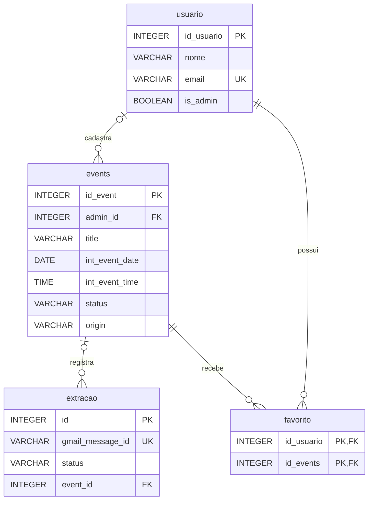

# Modelo de dados atual

**Fonte de verdade:** `database/001_schema.sql` no commit `036c3481d0dba6901c92df50311ac396f4f0682a`.

O schema atual possui quatro tabelas físicas: `usuario`, `events`, `extracao` e `favorito`. O modelo foi descrito a partir do SQL versionado e dos models SQLAlchemy correspondentes.

## 1. Entidades e tabelas

### `usuario`

| Coluna | Tipo | Restrições |
|---|---|---|
| `id_usuario` | INTEGER | PK, identity |
| `nome` | VARCHAR(90) | NOT NULL |
| `email` | VARCHAR(200) | NOT NULL, UNIQUE |
| `senha_hash` | VARCHAR(100) | NOT NULL |
| `nome_perfil` | VARCHAR(50) | NOT NULL |
| `is_admin` | BOOLEAN | NOT NULL, DEFAULT FALSE |
| `dt_cadastro` | DATE | NOT NULL, data padrão calculada em UTC-3 |

Restrições adicionais exigem que nome, e-mail, hash de senha e nome do perfil não sejam vazios. A identidade administrativa é representada por `is_admin = TRUE`; não existe tabela separada de administradores neste schema.

### `events`

| Coluna | Tipo | Restrições |
|---|---|---|
| `id_event` | INTEGER | PK, identity |
| `admin_id` | INTEGER | FK opcional para `usuario.id_usuario`, `ON DELETE SET NULL` |
| `title` | VARCHAR(200) | NOT NULL, não vazio |
| `description` | TEXT | NOT NULL, não vazio |
| `capacity` | INTEGER | NULL permitido; se preenchido, maior que zero |
| `event_type` | VARCHAR(50) | NOT NULL; `Palestra`, `Workshop`, `Hackathon` ou `Outro` |
| `int_event_date` | DATE | NOT NULL, data de início |
| `int_event_time` | TIME | NOT NULL, hora de início |
| `end_event_date` | DATE | NULL permitido |
| `end_event_time` | TIME | NULL permitido |
| `event_location` | VARCHAR(200) | NOT NULL, não vazio |
| `registration_link` | VARCHAR(500) | NOT NULL |
| `status` | VARCHAR(20) | NOT NULL, DEFAULT `active`; valores `active` ou `inactive` |
| `origin` | VARCHAR(20) | NOT NULL, DEFAULT `manual` |
| `created_at` | TIMESTAMPTZ | NOT NULL, DEFAULT CURRENT_TIMESTAMP |
| `updated_at` | TIMESTAMPTZ | NOT NULL, DEFAULT CURRENT_TIMESTAMP |

Restrições de período exigem que data e hora de término sejam informadas em conjunto e que o término não anteceda o início. Para eventos manuais, o link de inscrição deve ser uma URL HTTP(S). Para eventos de outras origens, o campo pode ser uma string vazia; quando preenchido, continua sujeito ao formato HTTP(S).

Índices definidos no schema:

- `ix_events_ativos_data`: eventos `active` por data, hora e identificador;
- `ix_events_event_type`: filtro por tipo;
- `ix_events_title_lower`: busca por título em minúsculas com `text_pattern_ops`.

### `extracao`

| Coluna | Tipo | Restrições |
|---|---|---|
| `id` | INTEGER | PK, identity |
| `gmail_message_id` | VARCHAR(64) | NOT NULL, UNIQUE |
| `source_email` | VARCHAR(255) | NOT NULL; a aplicação grava apenas o domínio do remetente |
| `status` | VARCHAR(20) | NOT NULL; valores controlados por CHECK |
| `extracted_data` | JSON | NULL permitido |
| `error_message` | VARCHAR(500) | NULL permitido |
| `event_id` | INTEGER | FK opcional para `events.id_event`, `ON DELETE SET NULL` |
| `created_at` | TIMESTAMPTZ | NOT NULL, DEFAULT CURRENT_TIMESTAMP |

Valores de `status` aceitos pelo schema: `processado`, `processado_ia`, `ignorado`, `nao_processado`, `extracao_incompleta`, `ignorado_duplicata` e `erro`. Quando `event_id` está preenchido, o status deve ser `processado` ou `processado_ia`.

A restrição `UNIQUE` sobre `gmail_message_id` sustenta a idempotência por mensagem. O vínculo com `events` usa `ON DELETE SET NULL` para preservar o histórico de processamento depois que um evento é removido.

### `favorito`

| Coluna | Tipo | Restrições |
|---|---|---|
| `id_usuario` | INTEGER | PK composta, FK para `usuario.id_usuario`, `ON DELETE CASCADE` |
| `id_events` | INTEGER | PK composta, FK para `events.id_event`, `ON DELETE CASCADE` |

A chave primária composta (`id_usuario`, `id_events`) impede a repetição do mesmo favorito. A tabela não possui identificador artificial nem timestamp próprio.

## 2. Relacionamentos e cardinalidades

| Origem | Destino | Cardinalidade | Implementação |
|---|---|---|---|
| `usuario` | `events` | Um usuário pode cadastrar zero ou muitos eventos; cada evento pode ter zero ou um administrador associado. | `events.admin_id` → `usuario.id_usuario` |
| `events` | `extracao` | Um evento pode ser associado a zero ou muitos logs; cada log pode apontar para zero ou um evento. | `extracao.event_id` → `events.id_event` |
| `usuario` | `events` | Muitos-para-muitos para favoritos. | Tabela associativa `favorito` |

O evento pode ter `admin_id` nulo, por exemplo, quando foi originado de e-mail. O registro de extração pode ter `event_id` nulo quando não gerou evento, quando foi descartado ou quando o evento associado foi excluído.

## 3. Diagrama lógico simplificado

O diagrama é uma visão resumida. Os tipos completos, comprimentos e constraints estão nas tabelas deste documento e no SQL versionado.

## 4. Ciclo de vida dos dados

- Eventos manuais são associados ao administrador autenticado por `admin_id`.
- Eventos extraídos podem não ter administrador associado; o vínculo de origem fica representado pelo log em `extracao`.
- Quando um evento expirado é removido pela rotina de limpeza, os logs de extração são preservados e seu `event_id` fica nulo.
- A exclusão de usuário ou de evento remove os favoritos relacionados por `ON DELETE CASCADE`.
- O corpo integral do e-mail não é persistido no log. A implementação guarda o identificador da mensagem, domínio de origem, status, dados extraídos e eventual erro minimizado.

## 5. Diferenças em relação a modelos anteriores

O schema atual não possui as tabelas `admins` ou `email_associado`. O administrador é um registro de `usuario` com `is_admin = TRUE`. A extração é registrada diretamente em `extracao`, com `gmail_message_id` e vínculo opcional a `events`.

Alguns documentos em `docs/architecture/database/` registram versões históricas que ainda descrevem cinco tabelas e/ou nomes de colunas anteriores. Para operações no banco, sempre confira o `database/001_schema.sql` da branch que está sendo executada.
