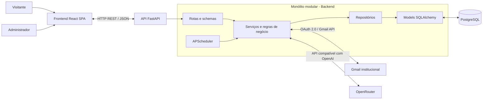
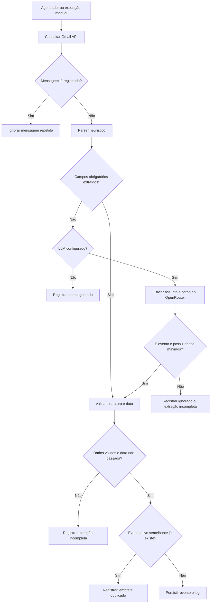

# Visão de arquitetura

**Referência de código:** commit `036c3481d0dba6901c92df50311ac396f4f0682a` (27/11/2026).

## 1. Visão geral

O CIn Event Hub centraliza a divulgação de eventos acadêmicos do Centro de Informática da UFPE. A solução tem uma interface web pública e administrativa, uma API REST e um banco de dados relacional. Também integra a caixa institucional do Gmail e um provedor de modelos de linguagem para auxiliar a extração de eventos a partir de e-mails.

A aplicação utiliza **monólito modular no backend**: autenticação, eventos, extração e rotinas agendadas são módulos do mesmo serviço FastAPI, executado como uma aplicação. O frontend React é um cliente SPA separado, servido pelo Vite no desenvolvimento e por Nginx na imagem de produção.

## 2. Diagrama de componentes

O diagrama representa responsabilidades lógicas. Não significa que cada caixa seja um processo, container ou microserviço independente.

## 3. Estilo arquitetural e organização em camadas

A aplicação combina uma SPA no frontend com uma API REST e um backend organizado em três camadas lógicas:

| Camada | Responsabilidade | Elementos do projeto |
|---|---|---|
| **Apresentação** | Exibir telas, navegação, estado de interface e interação com o usuário. | React, React Router, páginas, componentes, contextos e serviços HTTP em `frontend/src/`. |
| **Aplicação e negócio** | Expor os casos de uso, validar entradas e coordenar regras de negócio. | Routers FastAPI, schemas Pydantic e serviços em `backend/app/api/`, `backend/app/schemas/` e `backend/app/services/`. |
| **Persistência e dados** | Consultar e persistir informações, mapear entidades e aplicar integridade relacional. | Repositórios, models SQLAlchemy, conexão e PostgreSQL em `backend/app/repositories/`, `backend/app/models/`, `backend/app/database/` e `database/`. |

### Relação com MVC

A organização é **inspirada em MVC**, mas não é uma implementação clássica de MVC server-side. As rotas FastAPI desempenham papel semelhante ao de controllers; os models representam entidades persistidas; e a interface React concentra a camada de visualização. Serviços e repositórios foram separados para evitar que regras de negócio e consultas fiquem concentradas nas rotas.

### Monólito modular, não microserviços

Os módulos de autenticação, eventos, favoritos, extração e limpeza são executados pelo mesmo backend. A separação de pastas e responsabilidades facilita manutenção e testes, mas não existe comunicação de rede entre esses módulos nem implantação independente.

## 4. Frontend

O frontend é uma SPA construída com React 19, React Router 7 e Vite 8. As responsabilidades são separadas principalmente entre:

- `pages/`: páginas públicas e administrativas;
- `components/`: elementos de interface reutilizáveis;
- `contexts/` e `hooks/`: estado compartilhado de autenticação e tema;
- `services/`: comunicação HTTP e utilitários de navegação, agenda e eventos;
- `styles/`: folhas de estilo da aplicação.

No desenvolvimento, o Vite serve a aplicação. No container, o Dockerfile realiza o build com Node.js e entrega os arquivos estáticos pelo Nginx. O roteamento é feito no cliente; o Nginx possui configuração para encaminhar caminhos da SPA ao `index.html`.

## 5. Backend

O backend usa Python 3.12, FastAPI, Pydantic e SQLAlchemy 2.

| Módulo | Responsabilidade |
|---|---|
| `api/auth` | Login administrativo. |
| `api/eventos` | Listagem, consulta, criação, edição, exclusão, favoritos e limpeza. |
| `api/extracao` | Disparo manual, status e alertas da extração. |
| `core` | Configuração, autenticação JWT, dependências e utilitários centrais. |
| `services` | Casos de uso, regras de negócio, integração Gmail/LLM, validação e agendamento. |
| `repositories` | Consultas e operações de persistência. |
| `models` | Mapeamento das tabelas SQL para entidades ORM. |
| `schemas` | Contratos de entrada e saída da API. |

O ponto de entrada `backend/app/main.py` registra os routers, configura CORS e, no `lifespan`, verifica a existência das tabelas mapeadas, cria o administrador inicial quando configurado e inicia os dois agendadores.

## 6. Fluxo de extração de e-mails

O parser heurístico é o primeiro caminho. O modelo de linguagem é usado como fallback quando faltam campos obrigatórios. A validação e a verificação de duplicidade acontecem antes de publicar o evento. O log de extração registra o resultado, inclusive ignorados, falhas e duplicatas.

A implementação do cliente de IA está em `backend/app/services/ia_gemini/gemini_client.py`, mas a chamada HTTP usa o SDK `openai` com a URL base do OpenRouter. O nome interno `GeminiClient` é legado e não significa que a chamada use necessariamente o SDK oficial do Google.

## 7. Processos agendados

| Processo | Comportamento atual |
|---|---|
| Extração de e-mails | APScheduler executa em intervalo configurável; padrão de `EXTRACTION_INTERVAL_MINUTES`: 720 minutos (12 horas). |
| Limpeza de eventos expirados | APScheduler executa diariamente às 03:00 em `America/Recife`, salvo quando `CLEANUP_INTERVAL_MINUTES` define um intervalo alternativo. |

Os dois agendadores são iniciados no processo FastAPI. Portanto, não são workers independentes nem serviços distribuídos.

## 8. Interfaces externas

| Integração | Uso |
|---|---|
| PostgreSQL | Persistência, integridade referencial, constraints e índices. |
| Gmail API | Leitura da caixa institucional por OAuth 2.0, com escopo `gmail.readonly`. |
| OpenRouter | Fallback de extração de conteúdo de e-mail usando uma API compatível com OpenAI. |

## 9. Limitações arquiteturais conhecidas

- A autenticação JWT protege as operações administrativas. Os endpoints de favoritos usam `X-User-Id` e não dispõem de autenticação equivalente para alunos.
- O job scheduler está embutido no processo da API; executar múltiplas réplicas pode executar o mesmo job em mais de um processo.
- O CORS está configurado com `allow_origins=["*"]` no estado analisado; precisa ser restringido para produção.
- O arquivo `docker-compose.yml` contém variáveis de ambiente que não estão totalmente alinhadas ao contrato atual do backend. Ver [prontidão para produção](../operations/production-readiness.md).
- O fallback de IA recebe o assunto e o corpo do e-mail; a minimização implementada protege os logs persistidos, mas não elimina o envio do conteúdo bruto ao provedor externo.

## 10. Decisões associadas

Consulte os [ADRs](../adr/README.md), especialmente os registros sobre monólito modular, separação SPA/API, PostgreSQL, extração, autenticação e agendamento.
