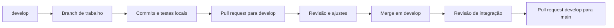

# Contribuição e fluxo de desenvolvimento

Este guia consolida práticas observadas no histórico de branches e pull requests do CIn Event Hub. Ele deve ser tratado como orientação operacional da equipe; regras formais do repositório podem ser atualizadas pelo grupo.

## 1. Branches

O histórico analisado utiliza `develop` como branch de integração das histórias e correções, com `main` como branch de referência final. As alterações são desenvolvidas em branches específicas e integradas por pull request.

Padrões de nome observados ou recomendados:

| Tipo | Exemplo |
|---|---|
| Funcionalidade | `feature/US-3.1-listagem-eventos` |
| Correção | `fix/correcao-extracao` |
| Testes | `test/roteiro-backend` |
| Documentação | `docs/adr-e-arquitetura` |
| Refatoração | `refactor/modelo-usuario` |

Fluxo recomendado:

Não faça trabalho direto em `main`. Antes de abrir PR, atualize a branch de trabalho com a base mais recente e resolva conflitos localmente.

## 2. Pull requests

A descrição do PR deve incluir:

- user story, issue ou problema atendido;
- resumo do comportamento alterado;
- arquivos/áreas relevantes;
- testes executados e resultado;
- mudanças de schema, variáveis de ambiente ou dependências;
- impactos na documentação e limitações conhecidas.

Se a alteração afeta outra parte do projeto, explicite o motivo e o impacto no PR para facilitar a revisão.

## 3. Commits

O histórico contém prefixos como `feat:`, `fix:`, `test:`, `refactor:` e `docs:`. Mantenha mensagens objetivas, com escopo claro e no imperativo quando possível. Não inclua arquivos `.env`, credenciais OAuth, tokens, dumps com dados pessoais ou outros segredos.

## 4. Quando atualizar a documentação

| Mudança | Documentos a revisar |
|---|---|
| Camadas, módulos, dependências ou integrações | `docs/architecture/overview.md` e ADR aplicável |
| Tabelas, colunas, constraints ou relacionamentos | `database/001_schema.sql`, models, testes e `docs/architecture/data-model.md` |
| Variáveis, inicialização, comandos ou containers | `docs/operations/local-development.md` |
| Segurança, privacidade ou escala | `docs/operations/production-readiness.md` e ADR aplicável |
| Contrato de endpoint ou paginação | README, OpenAPI/rotas e notas técnicas relevantes |
| Processo de teste | `docs/testing/strategy.md` |

## 5. Como registrar uma decisão arquitetural

Crie um ADR quando a decisão alterar uma propriedade estrutural ou tiver trade-offs relevantes. Registre contexto, decisão, alternativas, consequências e evidências. Não crie ADR para cada pequena mudança de código.

ADRs aceitos não devem ser apagados quando a decisão mudar: marque o antigo como `Substituído` e crie um novo registro que aponte para ele. Consulte `docs/adr/README.md`.

## 6. Checklist antes do PR

- [ ] A alteração está alinhada à user story e ao escopo do PR.
- [ ] Os testes pertinentes foram executados.
- [ ] Schema, model, seed e testes foram atualizados em conjunto, quando aplicável.
- [ ] Nenhuma credencial, arquivo `.env` ou dado pessoal foi adicionado.
- [ ] A documentação foi atualizada quando o comportamento ou a operação mudou.
- [ ] Limitações e riscos conhecidos estão descritos.
- [ ] O PR tem descrição suficiente para revisão por outro integrante.
